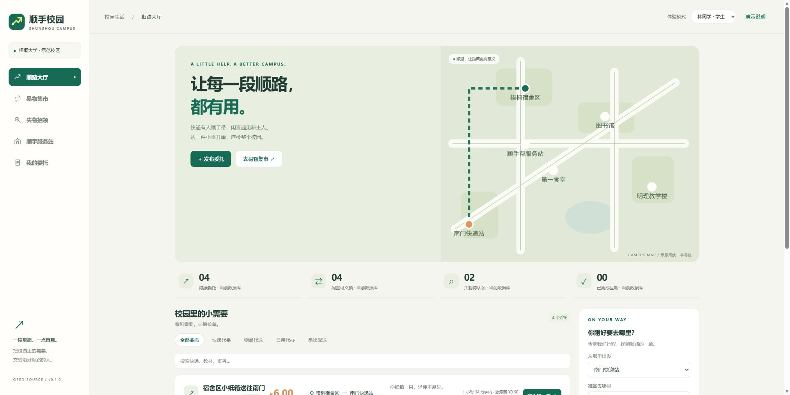
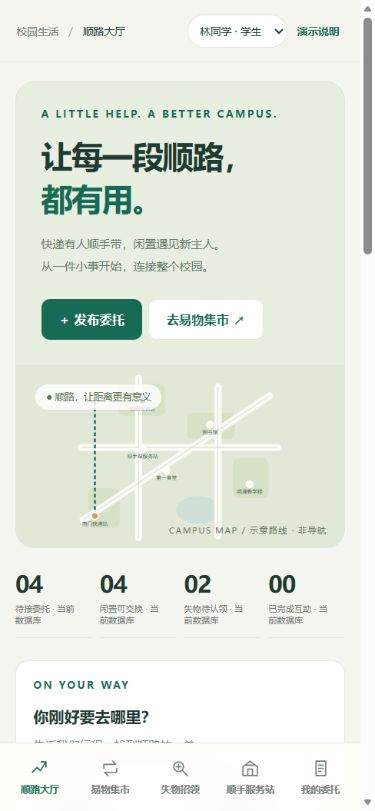

<div align="center">


# 顺手校园 · Shunshou Campus

**让每一段顺路，都有用。**

校园跑腿 × 闲置易物 × 失物招领 × 线下服务站

[](https://github.com/Liga-37wzy/shunshou-campus/actions/workflows/tests.yml)


[开始运行](#开始运行) · [体验路线](#五分钟体验路线) · [项目方案](docs/PROJECT.md) · [接口与架构](docs/ARCHITECTURE.md) · [下一步](docs/ROADMAP.md)

</div>

一个独立编写、可在本地运行的校园互助平台原型。学生可以发单，也可以利用自己的行程自愿接单；闲置物品可通过交换与配送继续流通；失物认领和线下寄存有各自的核验流程。

An original campus mutual-help prototype with explainable on-the-way task matching, barter-to-delivery workflows, private lost-item claims, and a community service hub. Responsive web UI, Flask API, SQLite persistence. No paid API keys needed for the local demo.

> **v0.1.0 的边界：** 这是可交互的 Web 原型，并非已经运营的小程序或配送服务。所有种子人物与校区均为虚构，金额只用于演示，不会实际收款、提现或派遣人员。源码公开不等于在线服务已部署。



## 三个核心设计

### 1. 先有行程，再找顺路的一单

输入出发地、目的地、空闲时间及最多绕行距离，平台解释每一条推荐：额外绕行多少米、预计增加几分钟、是否能赶在截止时间前完成。用户自行决定是否接单。

- 采用可解释的单订单插入模型，不依赖大模型。
- 排除自己的委托、过期订单和时间无法满足的订单。
- 接单上限由服务端控制；同时抢同一单时只有一个人成功。
- 当前使用虚构校园平面坐标，未连接真实步行道路与导航。

### 2. 易物与跑腿形成一条完整流程

发布“我有什么 / 想换什么” → 选择自己的物品提出交换 → 对方同意并同时预留两件物品 → 当面交接或生成双向配送单 → 双方确认收到。

同意一笔交换会关闭涉及相同物品的其他待处理申请。配送单的重复创建请求不会生成重复订单。往返配送不混入单程顺路推荐。

### 3. 给线上互助一个线下落点

服务站支持限时签到、寄存登记、工作人员确认入库、取件码领取及容量显示。失物认领线索只向相关参与者和工作人员显示，核验后记录归还。

未来的线下空间可以成为跑腿人员的休息与交接点、易物聚集地和失物保管点。本版本只实现管理流程，不代表已取得场地或学校合作。

## 当前已经可以做什么

| 模块 | 已实现 | 尚未实现 |
|---|---|---|
| 身份 | 账号注册、密码哈希、会话登录、演示身份切换、工作人员权限 | 微信登录、学校身份认证 |
| 跑腿 | 发布、筛选、接单、送达、确认完成、未接单取消、事件记录、费用计算 | 实际支付、退款、提现、纠纷仲裁 |
| 顺路匹配 | 绕行距离、截止时间、空闲时间、在途数量限制 | 真实地图、多单联合规划、强制自动派单 |
| 易物 | 物品发布、交换提议、双物品预留、双确认、往返配送联动 | 图片上传、聊天、双方协商撤销、评价 |
| 失物 | 拾获发布、私密认领申请、核验归还 | 图片检索、消息订阅、冒领争议处理 |
| 服务站 | 限时签到、寄存、入库、取件码、容量限制 | 多站点、二维码、交接凭据与完整审计 |

## 开始运行

需要 Python 3.11 或更新版本。Node.js 仅用于可选的 JavaScript 语法检查；运行页面不需要 npm 或前端构建。

```bash
git clone https://github.com/Liga-37wzy/shunshou-campus.git
cd shunshou-campus
python -m venv .venv
```

Windows PowerShell：

```powershell
.\.venv\Scripts\python.exe -m pip install -r requirements.txt
.\.venv\Scripts\python.exe server.py --demo
```

macOS / Linux：

```bash
.venv/bin/python -m pip install -r requirements.txt
.venv/bin/python server.py --demo
```

打开 [本地演示页面](http://127.0.0.1:8000)。右上角可以切换林同学、陈同学、周同学、服务站管理员。所有数据写入本机 `data/campus.sqlite`，刷新不会丢失。

不加 `--demo` 时不会创建演示人物、不会开放演示登录。无演示模式的新数据库只提供学生注册，不自动创建工作人员账号。

```bash
python server.py --database data/my-campus.sqlite
```

演示订单从数据库首次初始化起两小时后过期。需要全新演示时，请指定一个新的数据库文件，保留已有数据：

```bash
python server.py --demo --database data/demo-second.sqlite --port 8001
```

默认只监听 `127.0.0.1`。本机可使用浏览器设备模拟查看手机布局。远程手机访问、HTTPS 和公开部署需要另外配置；**不要把带角色切换的演示模式开放到公网。**

## 五分钟体验路线

1. **顺路接单**：林同学在大厅使用“南门快递站 → 梧桐宿舍区”，点击匹配；接取陈同学发布的快递单。去“我的委托”确认送达，再切到陈同学确认完成。
2. **闲置流通**：林同学在易物集市用收纳盒交换陈同学的阅读灯；切到陈同学同意。可以直接当面交换并由双方分别确认；也可以切回林同学先生成 5 元往返配送单，让周同学接取并完成交付，再完成交换确认。
3. **失物归还**：林同学对折叠伞提交认领特征；切到陈同学核验。切换周同学时看不到林同学的私密线索。
4. **线下接力**：林同学登记寄存并保存一次性显示的取件码；切到服务站管理员确认入库，再输入取件码记录领取。

<details>
<summary>手机布局预览</summary>



</details>

## 测试

```bash
python -m unittest discover -s tests -v
node --check web/app.js
```

18 项服务端行为测试覆盖：并发抢单、订单权限和状态、接单容量、过期与输入校验、服务费上限、路线可达性、交换锁定与配送幂等、双确认、认领线索隐私、寄存权限、取件码错误限制、请求来源、注册权限与数据持久化。

测试为每个案例创建独立临时数据库，不改动演示数据库。本项目测试脚本不执行自动批量删除。GitHub Actions 在 Python 3.11 / 3.13 上运行这些检查。

## 项目结构

```text
shunshou-campus/
├── server.py                 # Flask API、业务规则与 SQLite 初始化
├── web/                      # 无构建步骤的响应式页面
├── tests/test_flows.py        # 端到端业务 API 测试
├── docs/
│   ├── PROJECT.md            # 创业定位、功能与增长路径
│   ├── ARCHITECTURE.md       # 数据、状态流转、接口和匹配算法
│   ├── ROADMAP.md            # 小程序、多校区与真实运营计划
│   └── images/               # 实际运行截图
├── .github/workflows/        # 自动检查
├── SECURITY.md               # 已知边界与部署前事项
├── CONTRIBUTING.md
└── LICENSE
```

## 技术选择与使用边界

采用 Flask + SQLite + 原生 JavaScript，让学生团队可以在一台电脑上快速读懂并运行。数据库事务负责核心状态一致性，页面不在网络失败时伪造接单成功。

这是单校区、单机原型。真实运营前需补充内容审核、真实身份、支付对账、通知、投诉处理、风控限流、备份、运维和更完整的审计。Flask 开发服务器仅供本地使用；部署与安全边界详见 [SECURITY.md](SECURITY.md)。

## 开源与参考

代码、界面、标志和演示数据在本项目中独立实现，采用 [MIT License](LICENSE)。可按许可条款修改、分发及用于商业项目，需保留版权与许可声明；依赖遵循各自许可证。

项目前期调研参考了 [CampusGo](https://github.com/huangcancan-xbc/CampusGo)、[福U跑腿](https://github.com/Karrecy/fuu-run)、[Campus Student Exchanges App](https://github.com/huangxyy/Campus-student-exchanges-app--) 的公开功能说明，未复制其代码、图片或数据。

欢迎围绕一个清晰问题提交 Issue / PR，尤其是路线匹配、无障碍体验、小程序适配和真实校园试点反馈。
