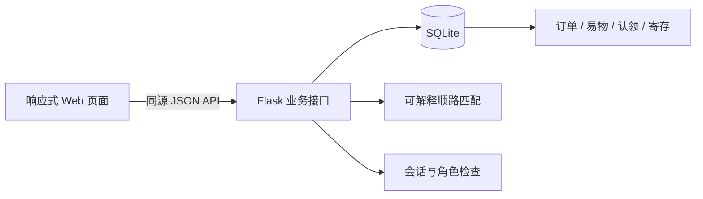
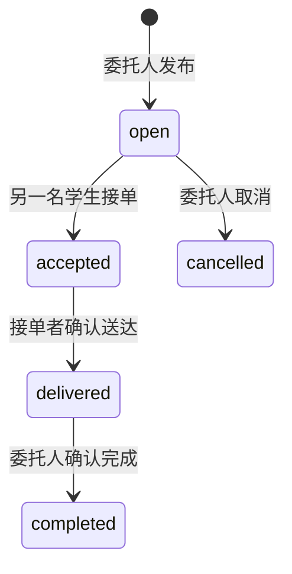

# 架构与接口

## 当前结构



这是单校区原型。无小程序 SDK、无第三方支付调用、无云存储、无外部地图请求。图中与页面中的校园地点为合成坐标。

## 订单状态



截止时间已过的 open 订单被列表和接单规则排除；数据库不会自动把它改为 cancelled。已接取的订单仍可完成。接单后取消、超时赔付和纠纷仲裁属于后续功能。

接单事务使用 `BEGIN IMMEDIATE` 串行验证状态与在途上限，确保同时接取不会重复分配。SQLite 适合此单机原型，不能据此宣称支持分布式高并发。

## 顺路推荐公式

设起点 S、个人目的地 E、取件点 P、送达点 D，距离函数 d 是演示坐标的欧氏距离：

```text
原行程 = d(S,E)
带单行程 = d(S,P) + d(P,D) + d(D,E)
额外绕行 = max(0, 带单行程 - 原行程)
额外耗时 = 额外绕行 / 70 + 2 分钟
顺路度 = clamp(round(100 - 额外绕行 / 12), 0, 100)
```

每分钟 70 米和 2 分钟交接时间是演示假设，不是实测数据。仅保留绕行不超过用户上限、总行程能在空闲时间内完成、预计送达早于订单截止时间的委托。先按顺路度降序，再按截止时间升序。

该算法一次只评估一单，不考虑已经接取订单的联合路线。双向易物配送因需要往返，明确排除在单程推荐之外，仍可在普通大厅接取。后续可接真实步行路径并使用 OR-Tools 建模容量、时间窗和取送先后关系。

## 易物规则

- 仅可拿自己的 available 物品交换另一人的 available 物品。
- 提议不锁定物品；对方同意时在同一个事务内预留两件物品。
- 其他涉及这两件物品的待处理申请同步关闭。
- 发起人可以生成一笔往返配送单；重复调用返回原订单编号。
- 有关联配送单时，需要配送完成（或未接单取消后自行交接）才能确认收到。
- 双方都确认后，将两件物品标为 exchanged。
- v0.1 不提供已同意交换的撤销或换物纠纷流程；请只用虚构数据体验。

## 接口摘要

所有写请求使用 JSON 对象，并携带 `X-Campus-Client: web`。会话采用 HttpOnly + SameSite=Strict Cookie；有 Origin 的写请求必须同源，不开放 CORS。除启动信息与账号接口，业务接口均需登录。

| 方法 | 路径 | 说明 |
|---|---|---|
| GET | `/api/bootstrap` | 当前身份、地点、分类、是否演示 |
| POST | `/api/auth/register` | username、password、name；只创建学生 |
| POST | `/api/auth/login` | 账号登录 |
| POST | `/api/auth/demo` | 演示模式的身份选择，非演示返回 404 |
| POST | `/api/auth/logout` | 退出登录 |
| GET / POST | `/api/tasks` | 委托列表 / 发布 |
| GET | `/api/matches?origin=gate&destination=dorm&minutes=30&max_detour=800` | 顺路推荐 |
| POST | `/api/tasks/{id}/accept\|deliver\|complete\|cancel` | 订单状态操作 |
| GET | `/api/tasks/{id}/events` | 参与者可见的订单记录 |
| GET / POST | `/api/items` | 闲置列表 / 发布 |
| GET / POST | `/api/exchanges` | 本人的交换 / 提议 |
| POST | `/api/exchanges/{id}/accept\|reject\|delivery\|confirm` | 交换操作 |
| GET / POST | `/api/found` | 拾获信息及有权查看的认领申请 / 发布 |
| POST | `/api/found/{id}/claim` | 提交私密 evidence |
| POST | `/api/claims/{id}/return` | 拾获者或站点核验归还 |
| GET | `/api/station` | 签到、容量、本人的寄存（工作人员看全部） |
| POST | `/api/station/checkin` | 1 小时有效签到 |
| POST | `/api/station/parcels` | 登记 label，返回一次取件码 |
| POST | `/api/station/parcels/{id}/store\|collect` | 工作人员入库 / 核验取件 |

费用均以整数分传输：`reward=500` 表示 5 元；平台费 `min(round_half_up(reward×10%), 200)`，仅展示模拟数值。

错误返回 JSON `{"error":"说明"}`；主要状态码为 400 参数错误、401 未登录、403 无权、404 不存在、409 状态冲突。服务端出错时页面展示失败，不在本地假装操作成功。

## 数据保留

SQLite 数据与随机会话密钥默认保存在被 Git 忽略的 `data/`。项目不提供删除账号或订单的入口；这避免课程演示中误删记录，但真实运营需要另行设计数据保留、导出与删除策略。

取件码只存 SHA-256 摘要，验证失败累计达到 5 次后停止自动领取。码遗失和次数超限均需人工核验；当前未提供管理员重置界面。所有演示角色可以由使用演示模式的人切换，所以演示模式不是安全隔离环境。
